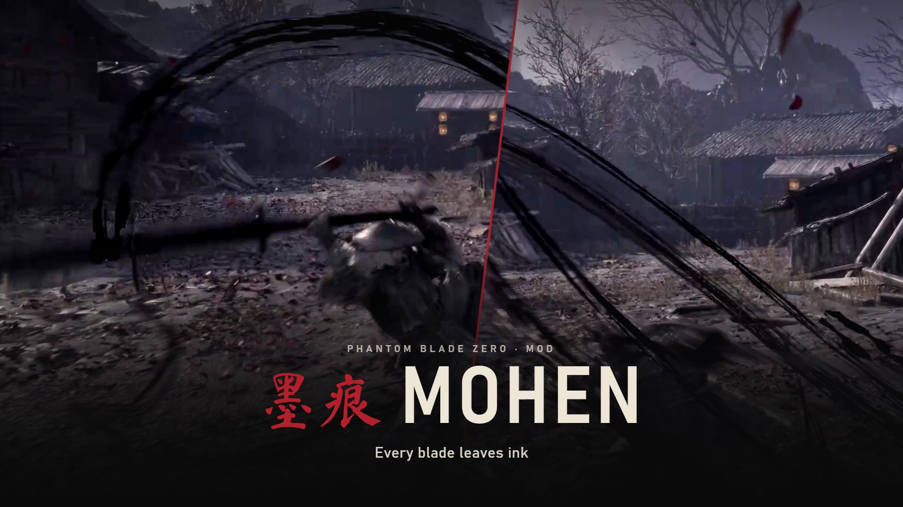
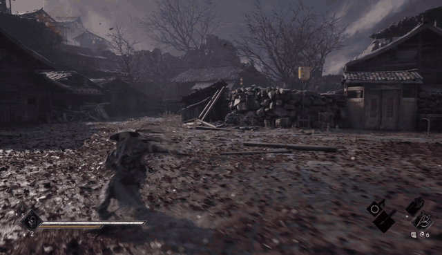
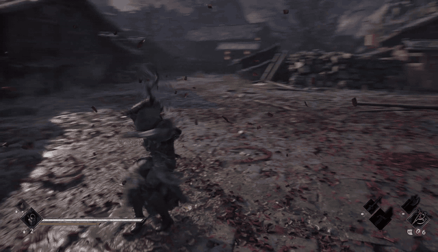
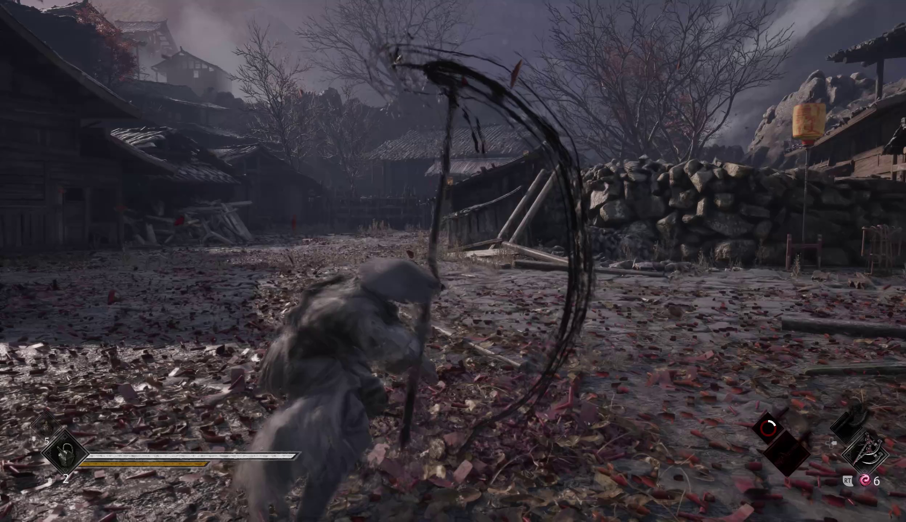
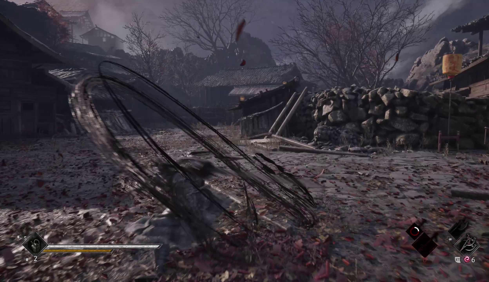
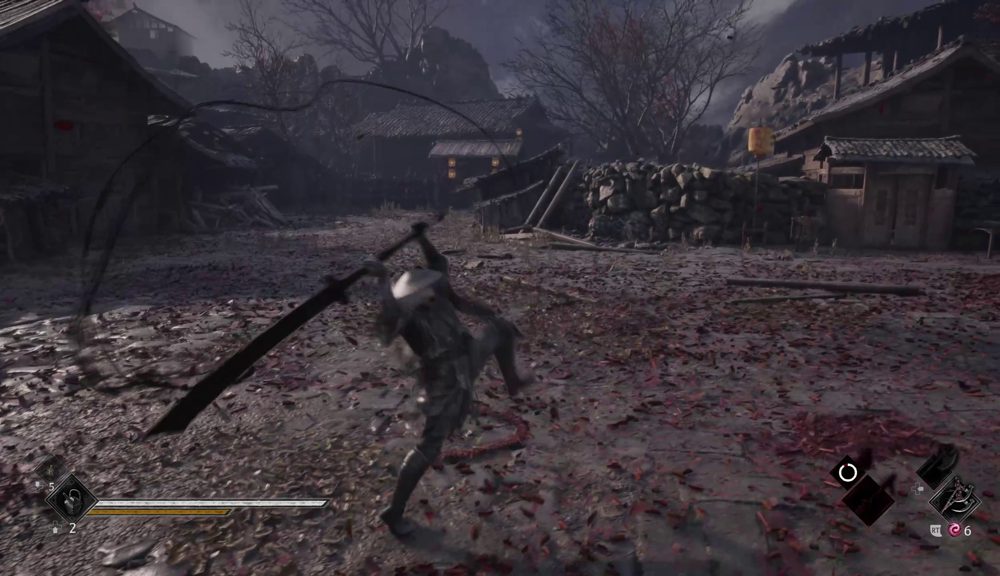
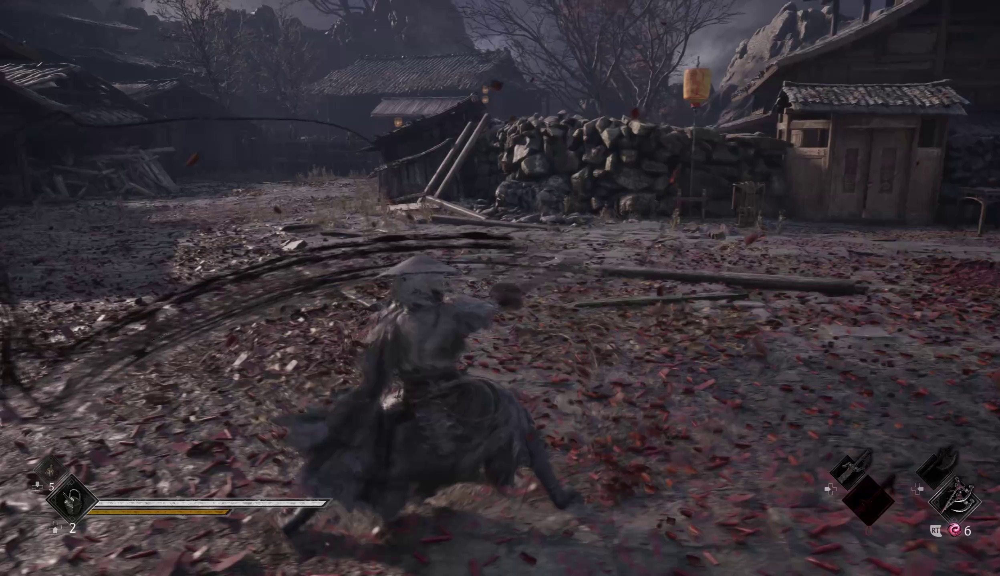

<p align="center"></p>

<p align="center">
  <a href="https://www.nexusmods.com/phantombladezero/mods/663"></a>
  <a href="https://github.com/ayokiru/pbz-mohen/releases/latest"></a>
  
  <a href="https://github.com/ayokiru/pbz-bladesmith"></a>
  <a href="LICENSE"></a>
</p>

<p align="center">
  <a href="#what-it-looks-like">Screenshots</a> &nbsp;·&nbsp;
  <a href="#what-changes">What changes</a> &nbsp;·&nbsp;
  <a href="#install">Install</a> &nbsp;·&nbsp;
  <a href="#with-other-mods">With other mods</a> &nbsp;·&nbsp;
  <a href="#build-it-yourself">Build it yourself</a>
</p>

Mohen makes almost every weapon in Phantom Blade Zero swing like an ink brush. Attacks leave black ink instead of the game's trails, and the blades themselves turn black. Stats, movesets and hitboxes stay the same.

## What it looks like

<table>
  <tr>
    <td width="50%"></td>
    <td width="50%"></td>
  </tr>
  <tr>
    <td align="center"><sub>Long weapon, ink loops</sub></td>
    <td align="center"><sub>Black greatsword, ink arcs</sub></td>
  </tr>
  <tr>
    <td width="50%"></td>
    <td width="50%"></td>
  </tr>
  <tr>
    <td width="50%"></td>
    <td width="50%"></td>
  </tr>
</table>

## What changes

Heavy, charged and special attacks draw a thick black brush stroke.

Light attacks leave thin ink that curls behind the blade: a bandit's blood trail, recolored black.

Blades, hilts and guards are recolored dark grey, so the engraving and the wear still show. Kicks and the dodge keep their own look.

A few things work differently:

- The Sanguine Twin gets black blades but no trails. The game draws none for it, and turning them on crashes the game when you draw the blades.
- The Lady's Fan gets the ink trails, but its blade keeps its colors. The blade is an effect, not a model, so there's no material to recolor.
- The equipment menu still shows each weapon's original look. You see the change once the weapon is in your hands.

## Install

1. Download [Mohen_1.0.zip](https://github.com/ayokiru/pbz-mohen/releases/latest/download/Mohen_1.0.zip).
2. Unpack it into the game folder, the one that has `ProjectPBZ` in it. The files land in `ProjectPBZ\Content\Paks\~mods`.
3. Start the game.

To remove it, delete `zzz_zMohen_P.pak`, `.ucas` and `.utoc` from `~mods`.

If you only want some weapons, every weapon also has its own zip in the [release](https://github.com/ayokiru/pbz-mohen/releases/latest), named after the weapon. Install those instead of the main file.

To keep every weapon's own look and get only the trails, install [Mohen_TrailsOnly_1.0.zip](https://github.com/ayokiru/pbz-mohen/releases/latest/download/Mohen_TrailsOnly_1.0.zip) instead of the main file. The blades stay as they are in the game, with no black recolor. The same zip has a `Per weapon` folder too: to get the trails on only some weapons, copy their folders' files into `~mods` instead of the whole thing.

For plain black blades with the game's own trails, install [Mohen_BladesOnly_1.0.zip](https://github.com/ayokiru/pbz-mohen/releases/download/blades-only-1.0/Mohen_BladesOnly_1.0.zip) instead of the main file. It has a `Per weapon` folder too.

## With other mods

When two paks change the same weapon, the game uses the one whose name sorts first, and capital letters sort before small ones. Mohen's pak starts with `zzz_z`, so a mod that changes a weapon wins on that weapon and Mohen covers the rest. With Sanguine Skins installed, for example, the Sanguine weapons keep their own look and trails.

## Build it yourself

The pak is a [Bladesmith](https://github.com/ayokiru/pbz-bladesmith) build from your own copy of the game, so after a game patch you can rebuild it instead of waiting for an update. [`recipes/mohen.json`](recipes/mohen.json) is the recipe, [`presets/ink.json`](presets/ink.json) holds the colors, and [`tools/make_recipe.py`](tools/make_recipe.py) writes the recipe from Bladesmith's weapon list.

```
bladesmith build recipes/mohen.json --install
```

You need a Bladesmith build newer than 0.5.3. The black blades and the material paths in presets came after it.

## License

[MIT](LICENSE) for the recipes, presets, scripts, texts and pictures in this repo. Phantom Blade Zero and the game data inside the pak belong to S-GAME.
